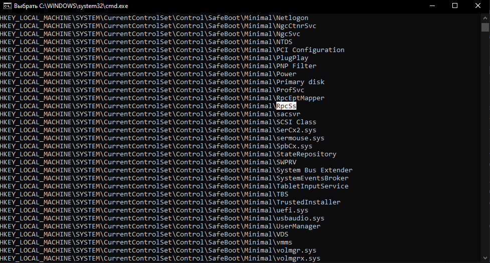
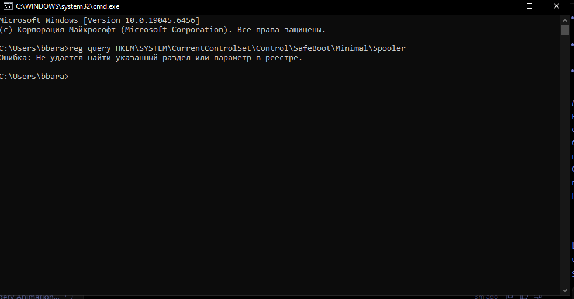
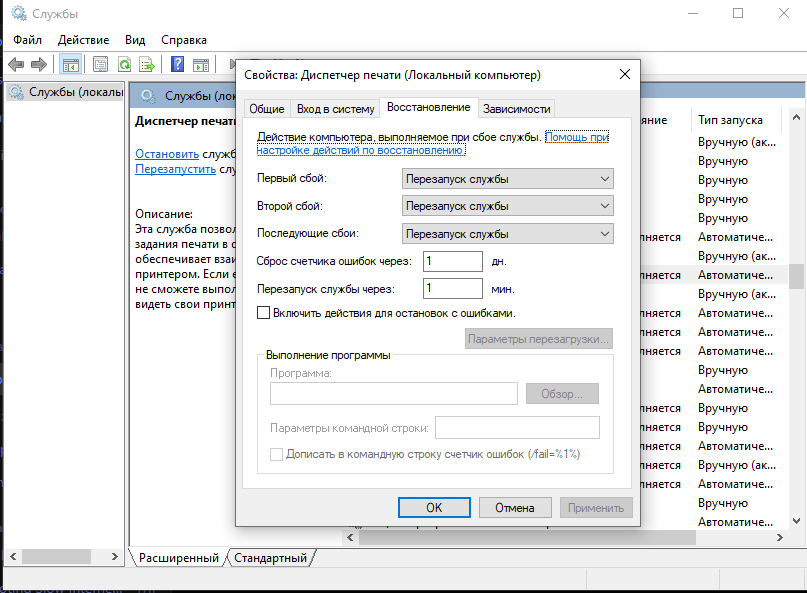
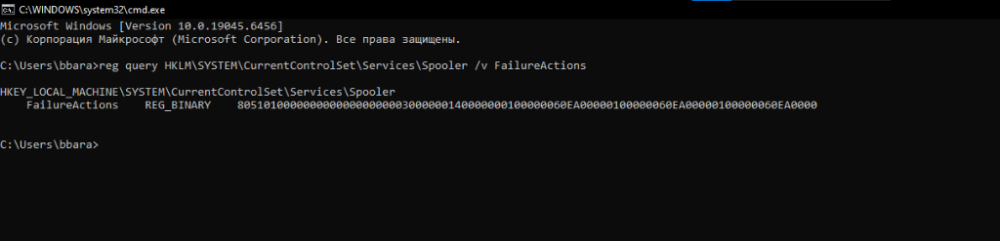

# Отчет по лабораторной работе №3

**Тема:** Исследование механизмов фильтрации драйверов ядра в Safe Mode и анализ отказоустойчивости служб Windows  
**Дисциплина:** Внедрение и поддержка программного обеспечения компьютерных систем  
**Инструменты:** Командная строка (Администратор), редактор реестра regedit, Диспетчер служб (services.msc)  

---

## Введение и цель работы

При внедрении программных комплексов у заказчика сбои часто происходят не из-за ошибок в логике интерфейса, а из-за конфликтов на уровне ядра и фоновых служб (кривые фильтры антивирусов, несовместимые драйверы оборудования, падения сервисов при скачках сети). 

**Цель работы:**
1. Изучить на уровне системного реестра архитектуру белого списка Безопасного режима (`SafeBoot\Minimal`) и понять, как ядро Windows отсекает лишние драйверы.
2. Проверить механизм изоляции на примере отключения некритичных служб (`Spooler`).
3. Настроить правила автореанимации и восстановления упавшей службы при сбоях.
4. Исследовать, как графические параметры восстановления из `services.msc` кодируются в бинарном ключе `FailureActions` в системном реестре.

---

## Ход работы

### Шаг 1. Анализ белого списка Безопасного режима в системном реестре

Запустил командную строку от имени администратора (`cmd` -> Запуск от имени администратора). Ввел команду для чтения ветки минимального безопасного режима:

```cmd
reg query HKLM\SYSTEM\CurrentControlSet\Control\SafeBoot\Minimal
```

В консоль вывалился список разрешенных компонентов. Внимательно просмотрел вывод:
- В списке присутствуют системные службы первой необходимости: `RpcSs`, `DcomLaunch`, `PlugPlay`, `CryptSvc`, `ProfSvc` (без них система не сможет даже войти в сеанс пользователя).
- Присутствуют записи для файловых систем: `File system`, `Boot file system`, `FsDepends.sys` (без них ядро не прочитает системный диск).
- Замечены GUID классов базовых устройств, например `{4D36E96B-E325-11CE-BFC1-08002BE10318}` (класс клавиатур), `{4D36E96E-...}` (мониторы), `{36FC9E60-...}` (USB-контроллеры).

*Примечание:* В методичке упоминается видеодрайвер `vgasave`. В актуальных версиях Windows вместо него в списке зарегистрированы драйверы базового видеоадаптера ядра `BasicDisplay.sys` и софтверного рендеринга `BasicRender.sys` (плюс `dxgkrnl.sys`). Принцип остался тем же: ядро блокирует любые проприетарные драйверы Nvidia/AMD и выводит картинку силами центрального процессора в базовом разрешении.

**Скриншот №1:** Консоль администратора с выводом команды `reg query` для ветки `SafeBoot\Minimal`, где видны ключи служб, файловых систем и GUID классов оборудования.



---

### Шаг 2. Моделирование конфигурационного конфликта (Проверка службы Spooler)

Чтобы убедиться, что служба с включенным в обычной системе автозапуском не сможет стартовать в Safe Mode, проверил наличие службы «Диспетчер печати» (`Spooler`) в белом списке:

```cmd
reg query HKLM\SYSTEM\CurrentControlSet\Control\SafeBoot\Minimal\Spooler
```

Консоль выдала сообщение:
```
ОШИБКА: Не удается найти указанный раздел или параметр в реестре.
```

Это наглядно демонстрирует логику работы безопасного режима:
1. В обычной системе служба `Spooler` имеет статус автозапуска (`Start = 0x2`), и при старте Windows менеджер управления службами (SCM) поднимает её автоматически.
2. Но в режиме Safe Mode менеджер SCM полностью игнорирует стандартный список автозапуска и смотрит **только** на белый список `SafeBoot\Minimal`.
3. Так как ключа `Spooler` там нет, ядро даже не пытается выделить под процесс память. Служба физически изолирована. Если внедряемый софт зависит от локальной печати, в Safe Mode он работать не сможет, но если именно кривой драйвер принтера вызывал крах системы — Safe Mode позволит ОС успешно загрузиться.

**Скриншот №2:** Окно командной строки с попыткой запросить раздел `Spooler` в `SafeBoot\Minimal` и полученной системной ошибкой отсутствия ключа.



---

### Шаг 3. Настройка отказоустойчивости и автовосстановления софта

При внедрении программных комплексов критически важные фоновые службы (например, службы интеграции с кассами, сервисы синхронизации баз данных или брокеры сообщений) могут падать из-за утечек памяти или сетевых тайм-аутов. Чтобы система не простаивала до прихода администратора, настроим автоматическую перезагрузку упавшего процесса на примере штатной службы печати.

1. Нажал `Win + R`, набрал `services.msc` и открыл классическую оснастку «Службы».
2. Нашел службу «Диспетчер печати» (`Spooler`), нажал правой кнопкой мыши -> «Свойства».
3. Перешел на вкладку **«Восстановление»** (Recovery).
4. Выставил конфигурацию согласно заданию:
   - **Первый сбой:** *Перезапуск службы*
   - **Второй сбой:** *Перезапуск службы*
   - **Последующие сбои:** *Перезапуск службы*
   - **Сброс счетчика ошибок через:** *1* дней
   - **Перезапуск службы через:** *1* мин.
5. Нажал «Применить» (окно свойств оставил открытым для проверки).

Теперь, если процесс службы упадет с необработанным исключением, Windows подождет 60 секунд и автоматически запустит его заново.

**Скриншот №3:** Открытое окно свойств службы «Диспетчер печати» на вкладке «Восстановление» со всеми заданными параметрами автоперезапуска.



---

### Шаг 4. Анализ структуры хранения параметров восстановления в реестре

Любая галочка в интерфейсе Windows — это просто запись в реестре. Чтобы увидеть, во что превратились наши настройки восстановления на системном уровне, вернулся в командную строку и выполнил:

```cmd
reg query HKLM\SYSTEM\CurrentControlSet\Services\Spooler /v FailureActions
```

Консоль вернула шестнадцатеричную строку бинарного типа `REG_BINARY`:

```
HKEY_LOCAL_MACHINE\SYSTEM\CurrentControlSet\Services\Spooler
    FailureActions    REG_BINARY    80510100000000000000000003000000140000000100000060EA00000100000060EA00000100000060EA0000
```

**Разбор бинарного представления под капотом:**
В документации Win32 API параметры восстановления описываются структурой `SERVICE_FAILURE_ACTIONS` и массивом структур `SC_ACTION`:
- Первые 4 байта (`dwResetPeriod`) задают время сброса счетчика сбоев в секундах. Например, 1 день = 86 400 секунд (в hex в little-endian это `80 51 01 00`).
- Далее идут смещения для сообщений о перезагрузке и команд запуска сторонних скриптов.
- Поле количества действий (`cActions` = 3, в hex: `03 00 00 00`).
- Затем следует массив действий: тип действия (значение `1` означает `SC_ACTION_RESTART` — перезапуск службы, `0` — ничего не делать, `2` — перезагрузка ПК, `3` — запуск программы) и задержка перед перезапуском в миллисекундах (1 минута = 60 000 мс = `60 EA 00 00` в hex).

Это подтверждает, что оснастка `services.msc` лишь транслирует графические настройки в низкоуровневые системные структуры, которые затем напрямую считывает Service Control Manager. При автоматизированном развертывании софта инженеру не нужно прощелкивать этот интерфейс руками — достаточно импортировать нужный reg-файл или передать параметры через команду `sc.exe failure`.

**Скриншот №4:** Консоль администратора с выводом команды `reg query ... /v FailureActions`, показывающая шестнадцатеричный ключ `REG_BINARY`.



---

## Ответы на инженерные вопросы для защиты

### 1. Объясните архитектурный смысл Шага 2. Почему отсутствие службы Spooler в ветке реестра SafeBoot\Minimal гарантирует, что она не запустится в Безопасном режиме, даже если в её личных настройках стоит статус «Автозапуск»?

В штатном режиме работы ОС диспетчер управления службами (Service Control Manager, `services.exe`) опрашивает ветку реестра `HKLM\SYSTEM\CurrentControlSet\Services\` и запускает все службы, имеющие параметр `Start = 2` (SERVICE_AUTO_START) или `Start = 1` (SERVICE_SYSTEM_START).

Когда ядро Windows загружается с флагом Безопасного режима (параметр BCD `/SAFEBOOT:MINIMAL`), логика SCM принципиально переопределяется. Менеджер ввода-вывода и SCM игнорируют стандартный триггер автозапуска и сверяются исключительно со списком разрешенных сущностей в ветке `HKLM\SYSTEM\CurrentControlSet\Control\SafeBoot\Minimal\`. 

Если имени службы (в данном случае `Spooler`) или GUID её класса оборудования нет в этом белом списке, SCM просто пропускает данную службу и не вызывает системные функции инициализации процесса. Белый список `SafeBoot\Minimal` имеет абсолютный системный приоритет над локальной конфигурацией службы. Это предотвращает старт любого потенциально проблемного стороннего кода.

---

### 2. В Шаге 3 мы настроили параметры вкладки «Восстановление». В каких ситуациях инженеру по внедрению софта необходимо прописывать эти правила для своих программных модулей, разворачиваемых у заказчика?

Такая конфигурация жизненно необходима для сервисов, обеспечивающих непрерывные технологические и бизнес-процессы, падение которых блокирует работу предприятия:
1. **Службы очередей и интеграционные шлюзы:** Демоны обмена с базами данных, брокеры сообщений (RabbitMQ, Kafka-коннекторы), службы синхронизации складских остатков. Кратковременный сетевой сбой или перезагрузка сервера БД могут вызвать исключение по таймауту и уронить сервис. Автоперезапуск позволяет сервису самостоятельно подняться, как только сеть восстановится, без вызова инженера посреди ночи.
2. **Сервисы взаимодействия с торговым оборудованием:** Драйверы фискальных регистраторов, кассовые демоны, службы обмена с терминалами эквайринга в ритейле или круглосуточных аптеках. Если из-за единичного сбоя памяти служба «умрет», продажи встанут. Автоматический перезапуск через 1 минуту вернет кассу в строй.

**Инженерная оговорка (важный нюанс внедрения):**  
Бесконечный перезапуск службы («Последующие сбои: Перезапуск») нельзя применять вслепую. Если в коде службы допущена критическая ошибка (поврежден файл конфигурации или происходит утечка памяти при обработке одного и того же «битого» пакета), служба уйдет в бесконечный цикл: *старт -> падение -> ожидание -> старт*. Это забьет процессор и переполнит журнал событий `System`. 

Грамотный инженер на этапе внедрения ограничивает количество автоматических попыток (например, 2 перезапуска), а на «последующие сбои» вешает запуск bat/powershell-скрипта (`SC_ACTION_RUN_COMMAND`), который шлет алерт в Telegram/Zabbix дежурному администратору или формирует аварийный дамп памяти (Crash Dump) для разработчиков.

---

### 3. Представьте, что разработанный вами драйвер вызывает BSoD (синий экран) при каждом включении ПК. Каким образом Безопасный режим поможет вам удалить этот поврежденный файл из системы и спасти компьютер заказчика от бесконечной перезагрузки?

Если сбойный драйвер не относится к критическим драйверам загрузки нулевого уровня (`SERVICE_BOOT_START`, которые поднимает еще `winload.efi` для чтения диска), а загружается на этапе `SERVICE_SYSTEM_START` (видеокарты, сетевые адаптеры, фильтры файловой системы, модули защиты), то сценарий спасения выглядит следующим образом:

1. **Загрузка в Safe Mode:**  
   Через среду восстановления Windows RE (или сочетание клавиш при старте) выбирается пункт «Включить безопасный режим». Поскольку наш драйвер не прописан в белом списке `SafeBoot\Minimal`, ядро Windows `ntoskrnl.exe` просто проигнорирует его и не станет загружать его бинарный код `.sys` в адресное пространство ядра. Компьютер успешно загрузится на базовом видеодрайвере.

2. **Локализация и изоляция:**  
   Так как драйвер не активен в памяти, его файл на диске **не заблокирован ядром ОС**. Инженер может свободно выполнить любые манипуляции:
   - Отключить автозапуск службы драйвера через командную строку:
     ```cmd
     sc config <Имя_Службы_Драйвера> start= disabled
     ```
   - Либо удалить/переименовать сам исполняемый файл в каталоге драйверов, чтобы исключить его повторную загрузку:
     ```cmd
     ren C:\Windows\System32\drivers\faulty_driver.sys faulty_driver.sys.bak
     ```
   - Удалить пакет драйвера из хранилища компонентов через утилиту `pnputil /delete-driver oemXX.inf /uninstall /force`.

3. **Использование подсистемы восстановления (System Restore):**  
   Если драйвер успел глубоко прописать свои хуки в реестре и повредить ветку `SYSTEM`, прямо из Безопасного режима запускается мастер восстановления системы (`rstrui.exe`). Поскольку служба VSS и драйвер `Volsnap.sys` поддерживают откат системных файлов и кустов реестра без повреждения пользовательских данных, ОС возвращается к точке восстановления, сделанной до установки проблемного пакета.

После перезагрузки система заказчика штатно поднимется в нормальном режиме, а инженер сможет забрать минидамп памяти из папки `C:\Windows\Minidump` для анализа ошибки разработчиками.

---

## Вывод

В ходе лабораторной работы я исследовал работу белого списка Безопасного режима (`SafeBoot\Minimal`) и практически подтвердил принцип изоляции: службы, отсутствующие в этом разделе реестра (как проверенный `Spooler`), блокируются ядром при старте системы независимо от флага автозапуска в их собственной ветке. 

Также на практике настроил параметры автоматического восстановления упавшей службы в оснастке `services.msc` и исследовал их низкоуровневое бинарное отражение в ключе `FailureActions` реестра Windows. Это дает четкое понимание того, как обеспечивать отказоустойчивость сервисов при внедрении софта у заказчика и как безопасно ликвидировать аварийные конфигурационные конфликты и сбои драйверов с помощью Safe Mode и подсистем восстановления ОС.
