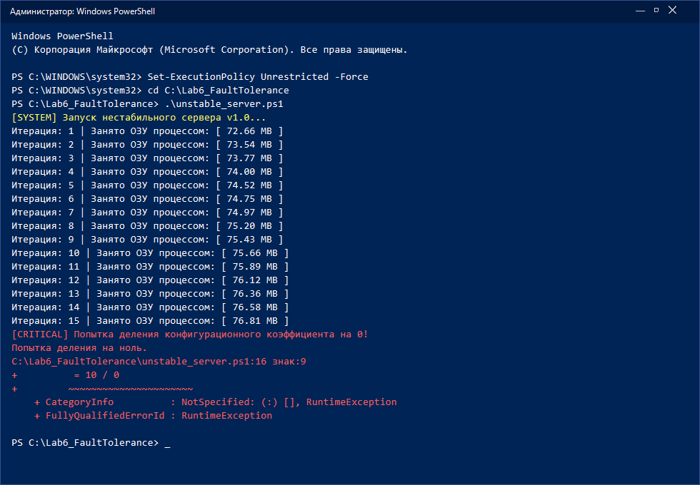
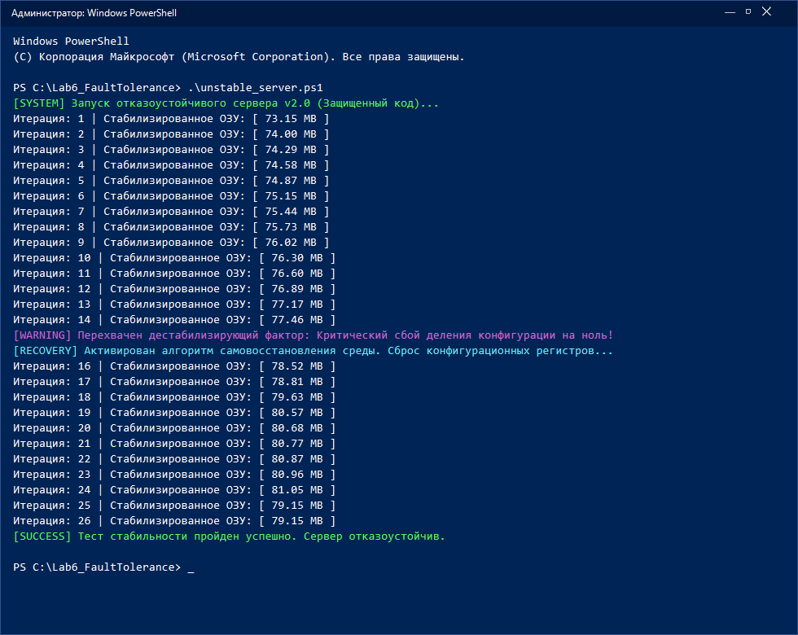

# Комплексная лабораторная работа №6

**Тема:** Исследование влияния дестабилизирующих факторов на программную среду и проектирование отказоустойчивых алгоритмов  
**Дисциплина:** Сопровождение и обслуживание ПО  
**Группа:** 41П-23 (4 курс)  
**Цель работы:** Изучить переход скрытого дефекта в состояние отказа, настроить перехват исключений, устранить утечку оперативной памяти и проверить работу защищенного кода.  
**Инструментарий:** PowerShell (Администратор), Блокнот, Диспетчер задач.  

---

## Краткая теория

В отличие от железа, софт со временем физически не изнашивается. Программа сбоит не из-за старости кода, а когда скрытый в ней дефект проявляется под действием дестабилизирующих факторов (кривые входные данные пользователя, разрыв сети, нехватка памяти в системе).

Цепочка развития любого сбоя строится по схеме:
**Ошибка (человек) -> Дефект / Баг (в коде) -> Отказ (падение программы)**

Чтобы приложение не падало намертво при первой же нештатной ситуации, применяют оборонительное программирование: не доверяют входным данным, оборачивают опасные места в блоки `try-catch` и освобождают занятые ресурсы, чтобы не забивать оперативку.

---

## Ход работы

### Шаг 1. Создание уязвимого скрипта с утечкой памяти и делением на ноль

1. Создал папку `C:\Lab6_FaultTolerance`.
2. В ней создал файл `unstable_server.ps1`.
3. Открыл файл в редакторе и вставил код уязвимого сервера v1.0.

В коде специально сделаны две проблемы:
- На каждой итерации в глобальный массив `$GlobalMemoryLeakBuffer` дописывается строка по 50 000 символов. Так как массив глобальный, сборщик мусора GC не может его выгрузить, и память постоянно растет.
- На 15-й итерации срабатывает условие `$cycle_counter -eq 15` и выполняется деление на ноль: `$fail_trigger = 10 / 0`.

Код скрипта:
```powershell
Clear-Host
Write-Host "[SYSTEM] Запуск нестабильного сервера v1.0..." -ForegroundColor Yellow
$GlobalMemoryLeakBuffer = @() # Глобальный массив (имитация кучи)
$cycle_counter = 0

while ($true) {
    $cycle_counter++
    # Симуляция утечки памяти: на каждом итерационном шаге забиваем ОЗУ мусорными строками
    $GlobalMemoryLeakBuffer += "Данные сессии пользователя №$cycle_counter : " + ("A" * 50000)

    # Вывод метрик в консоль
    $current_ram = [System.Diagnostics.Process]::GetCurrentProcess().WorkingSet64 / 1MB
    Write-Host "Итерация: $cycle_counter | Занято ОЗУ процессом: [ $(([math]::Round($current_ram, 2))) MB ]"

    # Провокация падения при внешнем триггере (критическое логическое исключение)
    if ($cycle_counter -eq 15) {
        Write-Host "[CRITICAL] Попытка деления конфигурационного коэффициента на 0!" -ForegroundColor Red
        $fail_trigger = 10 / 0
    }
    Start-Sleep -Milliseconds 200 # Искусственная задержка такта
}
```

---

### Шаг 2. Запуск и фиксация падения (отказ)

1. Запустил PowerShell от имени Администратора.
2. Ввел команду для разрешения скриптов:
```powershell
Set-ExecutionPolicy Unrestricted -Force
```
3. Перешел в папку и запустил сервер:
```powershell
cd C:\Lab6_FaultTolerance
.\unstable_server.ps1
```

**Что произошло:**
- На каждой итерации видно рост потребления ОЗУ процессом (с 72.66 МБ на 1 шаге до 76.81 МБ на 15 шаге). В Диспетчере задач на вкладке «Подробности» у `powershell.exe` тоже рос Working Set.
- На 15 итерации скрипт дошел до деления на ноль.
- Так как обработки ошибок не было, вылетело системное исключение `RuntimeException: Attempted to divide by zero`, скрипт сразу упал и закрылся с красной ошибкой. Произошел полный отказ программы.

**Скриншот №1:** Вывод консоли с ростом ОЗУ и крашем на 15 итерации:



---

### Шаг 3. Переписывание кода: защита от сбоев и утечек (v2.0)

Открыл `unstable_server.ps1` и переписал его по принципам оборонительного программирования:

1. **Убрал утечку памяти:** Вместо глобального массива сделал локальную переменную `$LocalBuffer` внутри блока `try`. После использования сразу вызывается `Remove-Variable LocalBuffer`, поэтому сборщик мусора GC сразу забирает эту память, и она не накапливается.
2. **Перехват деления на ноль:** Опасный код завернул в `try {} catch [System.DivideByZeroException] {}`. При ошибке скрипт не вылетает, а выводит фиолетовое предупреждение `[WARNING]`, сообщение о восстановлении `[RECOVERY]`, увеличивает счетчик и спокойно идет на следующую итерацию.
3. Добавил общий `catch` для любых других непредвиденных ошибок.

Обновленный код v2.0:
```powershell
Clear-Host
Write-Host "[SYSTEM] Запуск отказоустойчивого сервера v2.0 (Защищенный код)..." -ForegroundColor Green
$cycle_counter = 0

while ($true) {
    $cycle_counter++

    # Внедрение блока перехвата и локализации структурных отказов Try-Catch
    try {
        # Защитное подмножество (Defensive Block)
        if ($cycle_counter -eq 15) {
            # Перехватываем потенциальное деление на 0 до того, как оно уронит ядро процесса
            throw [System.DivideByZeroException] "Критический сбой деления конфигурации на ноль!"
        }

        # Имитация штатной работы с регулярной очисткой локальной кучи (Борьба с утечками)
        $LocalBuffer = "Данные сессии №$cycle_counter : " + ("A" * 50000)
        # В отличие от v1.0, мы не аккумулируем данные в глобальный массив вечно
        Remove-Variable LocalBuffer -ErrorAction SilentlyContinue 

    } catch [System.DivideByZeroException] {
        # Стратегия временной избыточности: логируем ошибку, изолируем сбойный модуль и продолжаем работу
        Write-Host "[WARNING] Перехвачен дестабилизирующий фактор: $($_.Exception.Message)" -ForegroundColor DarkMagenta
        Write-Host "[RECOVERY] Активирован алгоритм самовосстановления среды. Сброс конфигурационных регистров..." -ForegroundColor Cyan
        $cycle_counter++ # Пропускаем поврежденный такт данных и идем дальше
    } catch {
        Write-Host "[UNKNOWN ERROR] Неизвестный программный дефект заблокирован." -ForegroundColor Red
    }

    # Контрольный замер стабильности ОЗУ
    $current_ram = [System.Diagnostics.Process]::GetCurrentProcess().WorkingSet64 / 1MB
    Write-Host "Итерация: $cycle_counter | Стабилизированное ОЗУ: [ $(([math]::Round($current_ram, 2))) MB ]"

    if ($cycle_counter -gt 25) { 
        Write-Host "[SUCCESS] Тест стабильности пройден успешно. Сервер отказоустойчив." -ForegroundColor Green
        break 
    }
    Start-Sleep -Milliseconds 200
}
```

---

### Шаг 4. Проверка обновленного скрипта

Снова запустил скрипт в консоли:
```powershell
.\unstable_server.ps1
```

**Результаты проверки:**
1. Память перестала расти бесконечно: она держалась в районе 73–81 МБ на протяжении всех шагов.
2. На 15 итерации скрипт не упал. Появились сообщения `[WARNING]` и `[RECOVERY]`, после чего скрипт перескочил на 16 шаг и продолжил работать в штатном режиме.
3. На 26 шаге цикл завершился и вывел зеленый статус `[SUCCESS] Тест стабильности пройден успешно. Сервер отказоустойчив.`

**Скриншот №2:** Работа защищенного сервера v2.0 с перехватом ошибки на 15 шаге и стабильной памятью:



---

## Ответы на вопросы к защите

### 1. Цепочка развития сбоя в Шаге 1–2 (Ошибка -> Дефект -> Отказ)
- **Ошибка:** Это действие самого программиста. В нашем случае разработчик забыл проверить входные данные перед делением (не поставил проверку, что делитель равен 0) и объявил массив сессий в глобальной области без очистки.
- **Дефект (баг):** Конкретные строчки в коде, содержащие проблему: `$fail_trigger = 10 / 0` и постоянное добавление в `$GlobalMemoryLeakBuffer`. Пока цикл не дошел до 15 итерации, баг деления просто находился в коде и ждал своего триггера, а баг с памятью постепенно забивал кучу.
- **Отказ:** Момент, когда программа полностью перестает работать. Это произошло на 15-й итерации: процессор выполнил деление на 0, вылетело исключение `RuntimeException`, а так как перехвата не было, операционная система аварийно завершила скрипт.

### 2. Как удалось убрать утечку оперативной памяти в Шаге 3?
В первой версии данные копились в глобальный массив `$GlobalMemoryLeakBuffer`. В .NET сборщик мусора (GC) не имеет права трогать объекты, на которые есть ссылки из глобальных переменных, поэтому память не освобождалась.

В версии v2.0:
1. Убрали глобальный массив и перешли на локальную переменную `$LocalBuffer` внутри блока `try`.
2. После каждой итерации вызываем `Remove-Variable LocalBuffer`. Ссылка на строку удаляется, объект становится мусором, и сборщик GC спокойно его освобождает. За счет этого Working Set зафиксировался на уровне ~75–80 МБ и перестал расти.

### 3. Какой метод отказоустойчивости иллюстрирует try-catch и зачем это нужно у заказчика?
Здесь показаны два метода из теории:
- **Оборонительное программирование (Defensive Programming):** Опасный участок изолируется в блоке `try`, чтобы возможный сбой не затронул остальную часть программы.
- **Временная избыточность:** Скрипт не падает при ошибке, а перехватывает ее в `catch`, логирует сообщение, сбрасывает сбойное состояние и переходит к следующей итерации.

**Зачем это в реальных системах:**  
Если на рабочем сервере у заказчика (например, веб-сайт, база данных или бэкенд) один пользователь введет некорректные данные или поймает ошибку деления на 0, без `try-catch` упадет весь процесс сервера. Из-за одного запроса перестанет работать вся система для всех остальных пользователей. Обработка исключений изолирует сбой одного запроса, записывает лог и позволяет серверу работать дальше без падений.
