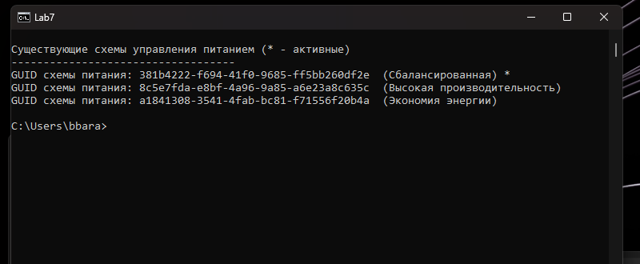
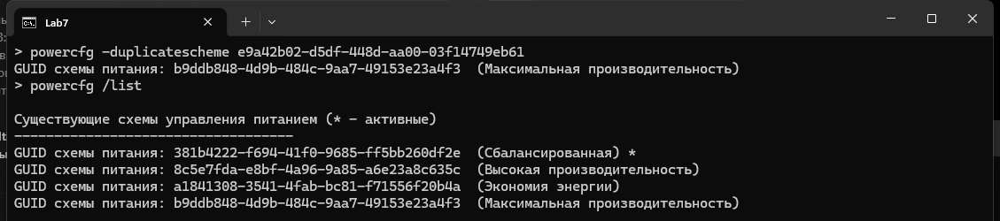
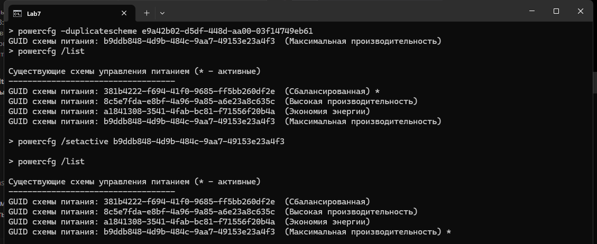
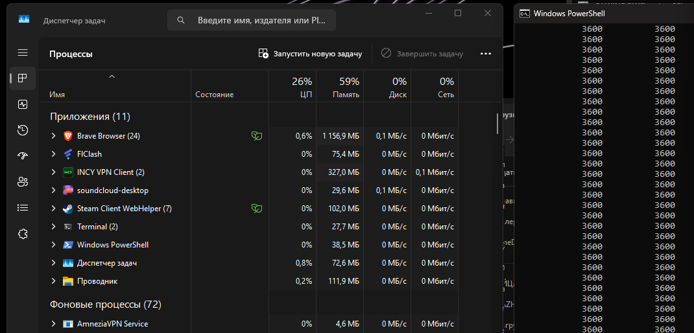
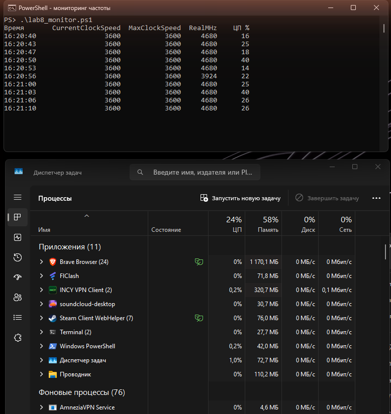
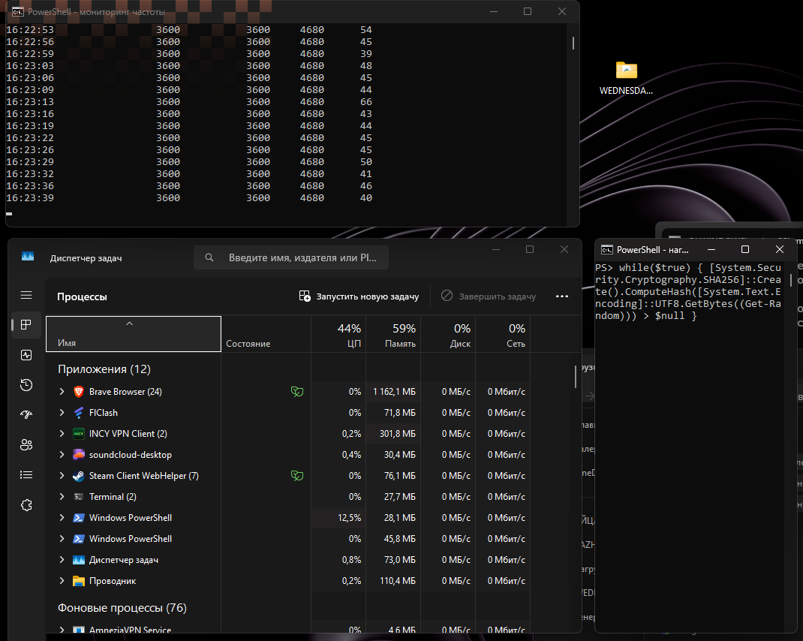
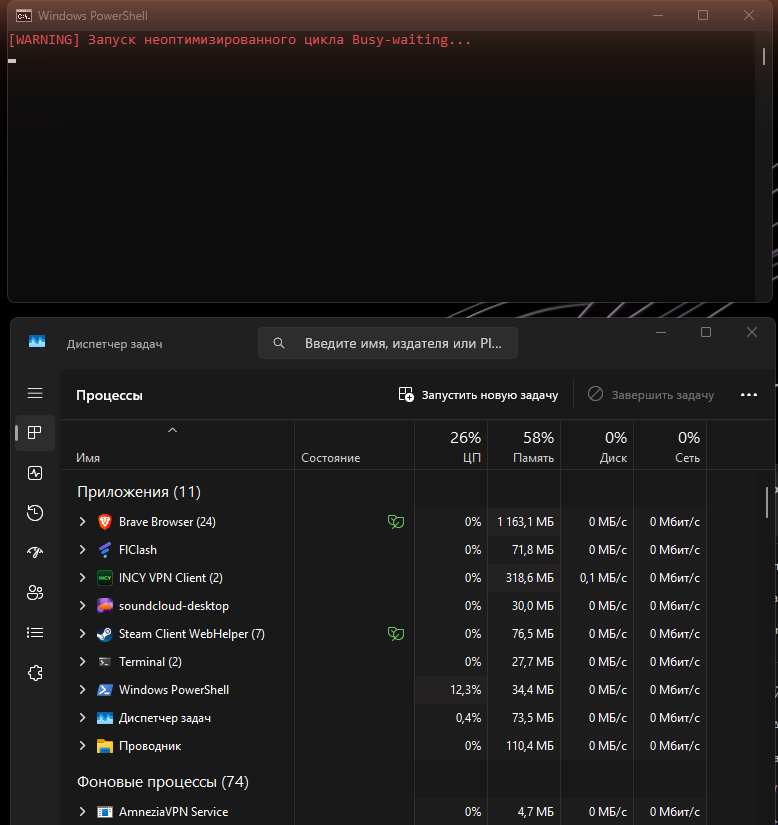
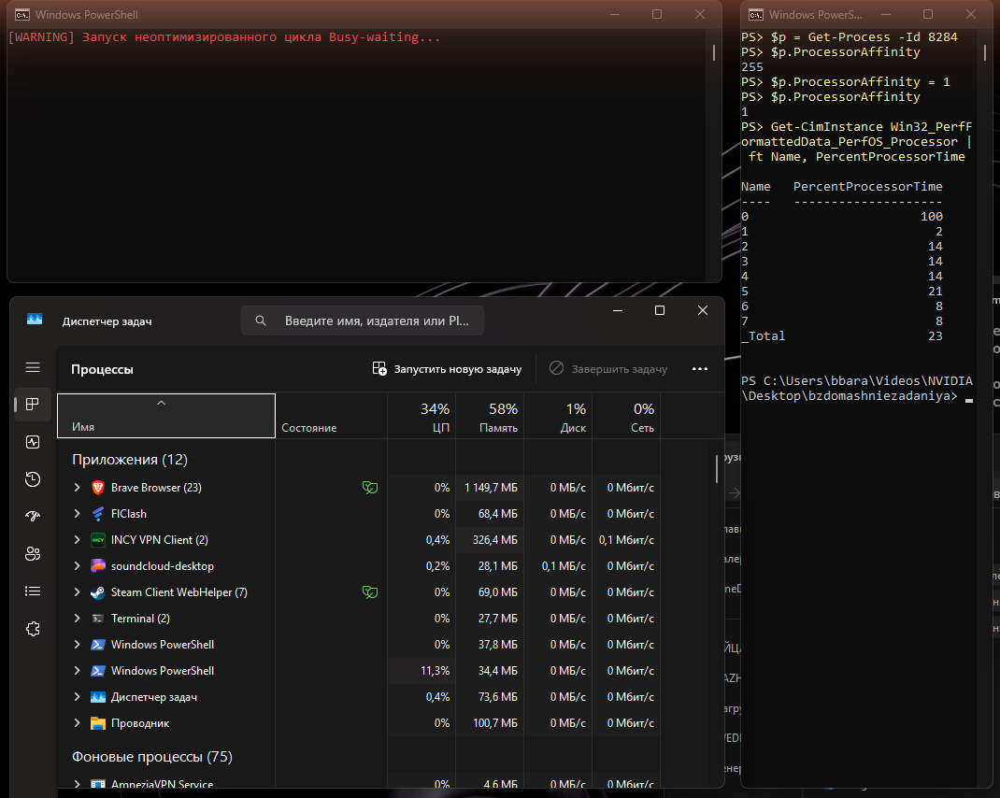
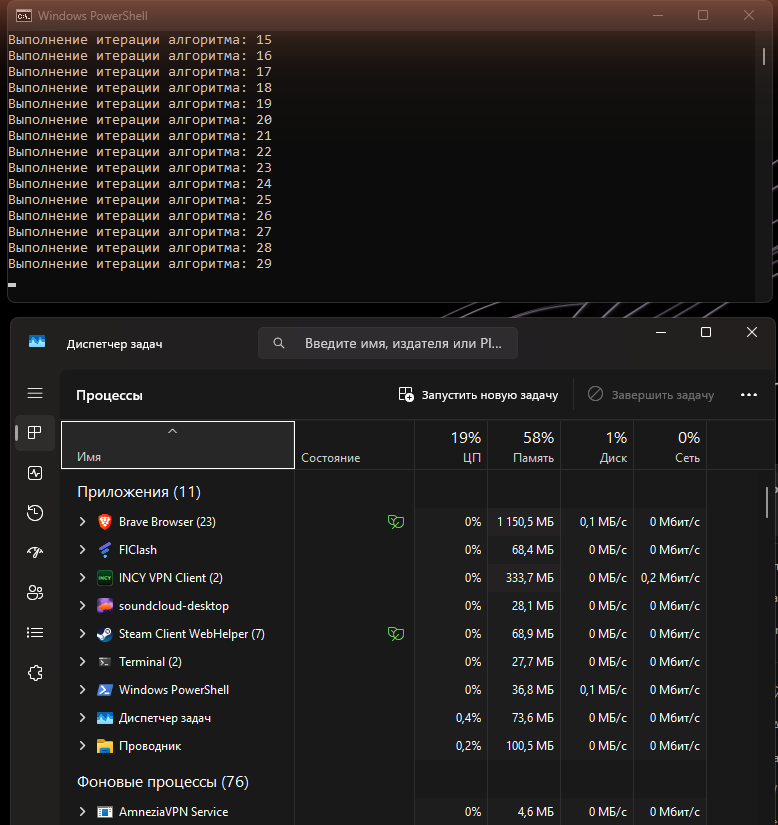

# Отчет по лабораторным работам №7, №8, №9

**Тема:** Управление электропитанием Windows, мониторинг частоты процессора и оптимизация процессорного времени

Все работы делал на своем ПК: Windows 11 Pro, процессор Intel Core i7-9700K (8 ядер, 8 потоков, базовая частота 3,6 ГГц).

---

## Лабораторная работа №7. Схемы электропитания и powercfg

### Шаг 1. Список схем питания

Открыл командную строку и выполнил:

```
powercfg /list
```

В системе нашлось три схемы:

| GUID | Схема |
|---|---|
| `381b4222-f694-41f0-9685-ff5bb260df2e` | Сбалансированная (активная, со звездочкой) |
| `8c5e7fda-e8bf-4a96-9a85-a6e23a8c635c` | Высокая производительность |
| `a1841308-3541-4fab-bc81-f71556f20b4a` | Экономия энергии |

GUID сбалансированной схемы записал отдельно, он нужен, чтобы потом вернуть все как было.

**Скриншот №1:**



### Шаг 2. Разблокировка схемы «Максимальная производительность»

Чтобы не копировать GUID руками, сложил команды шагов 2 и 3 в файл [lab7_ultimate.bat](cpu_scripts/lab7_ultimate.bat) и запускал его от имени администратора. Первая команда в нем:

```
powercfg -duplicatescheme e9a42b02-d5df-448d-aa00-03f14749eb61
```

Она делает копию скрытого шаблона Ultimate Performance и выдает для копии новый GUID. Этот GUID отличается от `e9a42b02-...`, поэтому пример из методички `powercfg /setactive e9a42b02-...` в лоб не сработает: активировать нужно именно копию. В bat-файле новый GUID вытаскивается из вывода команды через `for /f "tokens=4"` (четвертое слово в строке `GUID схемы питания: ...`).

У меня копия получила GUID `b9ddb848-4d9b-484c-9aa7-49153e23a4f3`. После этого `powercfg /list` показывает четвертую строку, «Максимальная производительность».

**Скриншот №2:**



### Шаг 3. Активация схемы

Дальше bat-файл выполняет команду с новым GUID и снова выводит список:

```
powercfg /setactive b9ddb848-4d9b-484c-9aa7-49153e23a4f3
```

Звездочка переехала со «Сбалансированной» на «Максимальную производительность».

**Скриншот №3:**



После скриншота вернул сбалансированную схему (bat делает это сам после нажатия клавиши):

```
powercfg /setactive 381b4222-f694-41f0-9685-ff5bb260df2e
```

---

## Лабораторная работа №8. Частота процессора под нагрузкой

### Шаг 1. Мониторинг в покое

Запустил диспетчер задач и PowerShell с командой из задания:

```powershell
while($true) { Get-CimInstance Win32_Processor | Select-Object CurrentClockSpeed, MaxClockSpeed; Start-Sleep -Seconds 2 }
```

Тут обнаружилась проблема: `CurrentClockSpeed` все время показывал 3600, ровно как `MaxClockSpeed`. На моем процессоре WMI-класс `Win32_Processor` отдает базовую частоту и турбо-режим не видит, поэтому по этой команде изменение частоты не увидеть.

**Скриншот №1 (команда из задания):**



Поискал, откуда тогда берется реальная частота. В Windows есть счетчик производительности `% Processor Performance`: это текущая частота в процентах от базовой, больше 100% означает работу в Turbo Boost. Написал небольшой скрипт [lab8_monitor.ps1](cpu_scripts/lab8_monitor.ps1), который раз в 2 секунды выводит обе частоты и общую загрузку ЦП:

```powershell
$cpu  = Get-CimInstance Win32_Processor
$pi   = Get-CimInstance Win32_PerfFormattedData_Counters_ProcessorInformation -Filter "Name='_Total'"
$real = [int]($cpu.MaxClockSpeed * $pi.PercentProcessorPerformance / 100)
```

Сначала пробовал через `Get-Counter`, но в отдельном окне консоли он стал падать с ошибкой `InvalidResult`, поэтому взял тот же счетчик через CIM-класс.

В покое реальная частота получилась 4680 МГц, один раз опустилась до 3924. То есть процессор и без нагрузки работает выше базовой: в фоне открыты браузер, VPN, Steam и прочее, общая загрузка 15-40%, и сбалансированная схема держит буст.

**Скриншот №1 (доработанный мониторинг, покой):**



### Шаг 2. Стресс-тест

Во втором окне PowerShell запустил вычисление хэшей:

```powershell
while($true) { [System.Security.Cryptography.SHA256]::Create().ComputeHash([System.Text.Encoding]::UTF8.GetBytes((Get-Random))) > $null }
```

Процесс PowerShell в диспетчере сразу показал 12,5%. У меня 8 логических процессоров, а цикл однопоточный, так что он забирает ровно одно ядро: 100% / 8 = 12,5%.

### Шаг 3. Проверка на троттлинг

Нагрузку держал около трех минут. Частота все это время стояла на 4680 МГц и ниже базовой 3600 не падала, значит троттлинга нет. Это ожидаемо: нагружено одно ядро из восьми, кулер справляется. Чтобы реально нагреть процессор, надо запускать такой цикл в 8 окнах сразу (или использовать стресс-тест типа Prime95).

Общая загрузка ЦП под нагрузкой выросла с 15-40% до 40-66%.

**Скриншот №2:** слева сверху мониторинг, справа окно с нагрузкой, внизу диспетчер задач.



Остановил тест через Ctrl+C во втором окне.

---

## Лабораторная работа №9. Busy-waiting, привязка к ядрам и Start-Sleep

### Шаг 1. Плотный цикл

Создал файл `cpu_test.ps1` с кодом из задания (обе версии лежат в [cpu_scripts](cpu_scripts/)):

```powershell
Clear-Host
Write-Host "[WARNING] Запуск неоптимизированного цикла Busy-waiting..." -ForegroundColor Red
$flag = $true
while ($flag) {
    # Пустой цикл без задержек. Сжигает 100% выделенного ядра CPU
}
```

Две мелочи при запуске. Во-первых, в методичке команда написана как `.cpu_test.ps1`, а правильно `.\cpu_test.ps1`, без `.\` PowerShell скрипт из текущей папки не запускает. Во-вторых, по умолчанию Windows не дает запускать .ps1 (политика выполнения), поэтому запускал PowerShell с параметром `-ExecutionPolicy Bypass`.

Файл сохранил в UTF-8 с BOM. Без BOM Windows PowerShell 5.1 читает файл в кодировке ANSI, и русский текст в `Write-Host` превращается в кракозябры.

Результат: процесс `Windows PowerShell` стабильно держит 12,3-12,6% ЦП, это одно логическое ядро из восьми. Загрузку видно на вкладке «Процессы».

**Скриншот №1:**



### Шаг 2. Привязка к ЦП 0 (Processor Affinity)

Сходство задал не через окно «Задать сходство» в диспетчере, а через PowerShell, у процесса есть свойство `ProcessorAffinity`. Это та же настройка, только в виде битовой маски: каждый бит соответствует одному логическому процессору.

```powershell
$p = Get-Process -Id 8284
$p.ProcessorAffinity          # 255 = 11111111, все 8 ядер
$p.ProcessorAffinity = 1      # 00000001, только ЦП 0
```

Проверка по каждому ядру через `Win32_PerfFormattedData_PerfOS_Processor`: ЦП 0 загружен на 100%, остальные от 2 до 21%. До привязки планировщик перекидывал поток между ядрами, и нагрузка размазывалась (одно ядро было по 22-40%). После привязки весь цикл сидит на нулевом ядре, а остальные свободны.

**Скриншот №2:**



Остановил скрипт.

### Шаг 3. Оптимизированный код со Start-Sleep

Заменил код в `cpu_test.ps1`:

```powershell
Clear-Host
Write-Host "[SUCCESS] Запуск оптимизированного кода..." -ForegroundColor Green
for ($i=1; $i -le 50; $i++) {
    # Выполняем полезную логику
    Write-Host "Выполнение итерации алгоритма: $i"
    # Уступаем квант времени планировщику ОС. Поток засыпает, переводя ядро в C-state
    Start-Sleep -Milliseconds 50 
}
```

Скрипт отработал все 50 итераций, и пока он шел, процесс PowerShell в диспетчере показывал 0%.

**Скриншот №3:** скрипт на 29-й итерации, у Windows PowerShell 0% ЦП.



---

## Ответы на контрольные вопросы

### 1. Физический смысл шага 2 в ЛР7. Чем «Максимальная производительность» отличается от «Сбалансированной» по C-states и P-states?

Схема Ultimate Performance уже есть в Windows как встроенный шаблон с фиксированным GUID `e9a42b02-d5df-448d-aa00-03f14749eb61`, но в список ее не выводят, особенно на ПК, которые не считаются рабочими станциями. Команда `-duplicatescheme` копирует этот шаблон в обычную пользовательскую схему, и после этого ее можно выбрать. Сами правила этой схемы уже были в системе, команда только делает их доступными.

Разница со сбалансированной схемой:

- P-states. В сбалансированной схеме минимальное состояние процессора маленькое (5%), и при слабой нагрузке ОС снижает частоту и напряжение. Когда нагрузка появляется, частоту приходится поднимать, а это занимает время. В максимальной схеме минимальное состояние 100%, частота не опускается ниже базовой, и разгона с низких частот нет.
- C-states. Сбалансированная схема охотно отправляет простаивающие ядра в глубокий сон (C6 и глубже) и паркует ядра. Выход из глубокого сна стоит десятки и сотни микросекунд. Максимальная схема парковку отключает и держит ядра в неглубоком сне, поэтому они просыпаются быстрее.
- Кроме процессора она отключает энергосбережение на других устройствах: PCI Express, USB, жестких дисках. Это тоже убирает задержки на «пробуждение» железа.

Платить за это приходится энергопотреблением и нагревом. На моем ПК даже на сбалансированной схеме частота в покое была 4680 МГц, потому что в фоне всегда есть нагрузка. Поэтому на десктопе выигрыш заметен скорее по задержкам отклика, чем по частоте.

### 2. Что такое термотроттлинг и какую защитную функцию он выполняет?

Термотроттлинг означает, что процессор сам снижает свою производительность при перегреве. Когда температура кристалла доходит до критической (у i7-9700K это 100 °C), процессор сбрасывает множитель и напряжение, а при сильном перегреве начинает пропускать такты. Если и это не помогает, компьютер аварийно выключается.

Защищает он сам кристалл: от постоянной работы на предельной температуре транзисторы деградируют, а совсем без защиты процессор может выйти из строя.

На софт это влияет так: программа начинает работать медленнее, хотя код не менялся. При этом диспетчер задач может показывать 100% загрузки, потому что процессор занят все время, просто выполняет меньше инструкций в секунду. Для сопровождения это неприятная ситуация: пользователь жалуется, что программа тормозит, а причина в забитом пылью кулере или высохшей термопасте. Поэтому при разборе жалоб на производительность надо смотреть не только загрузку, но и частоту с температурой.

В моем тесте троттлинга не было: однопоточная нагрузка три минуты, частота все время 4680 МГц.

### 3. За счет чего Start-Sleep снизил загрузку ядра до нуля?

Планировщик Windows раздает процессорное время потокам, которые готовы выполняться (состояние Ready), квантами по несколько миллисекунд. В пустом цикле `while ($flag) {}` поток никогда не говорит системе, что ему нечего делать. Он все время готов к выполнению, получает квант за квантом и тратит их на проверку `$flag`. Для ОС такой поток ничем не отличается от полезной работы, поэтому ядро загружено на 100%.

`Start-Sleep -Milliseconds 50` внутри вызывает системное ожидание по таймеру. Поток переходит в состояние ожидания (Waiting), и планировщик убирает его из очереди готовых. Пока он спит, на ядре выполняются другие потоки, а если их нет, ядро уходит в C-state. Когда таймер срабатывает, поток снова становится готовым, выполняет `Write-Host` (это доли миллисекунды) и опять засыпает. Получается, что из каждых 50 с лишним миллисекунд поток реально работает очень малую часть, и в диспетчере это округляется до 0%.

Тот же принцип в теории описан для `dataReadyEvent.WaitOne()`: вместо постоянной проверки флага поток ждет события, и ОС будит его, только когда данные готовы.

---

## Вывод

В ЛР7 я посмотрел схемы питания через `powercfg`, разблокировал скрытую схему «Максимальная производительность» и переключался между схемами по GUID. Неочевидный момент: `-duplicatescheme` создает копию с новым GUID, и активировать нужно именно ее.

В ЛР8 выяснилось, что `Win32_Processor.CurrentClockSpeed` на моем процессоре всегда показывает базовые 3600 МГц, и реальную частоту пришлось брать из счетчика `% Processor Performance`. Под однопоточной нагрузкой процессор держал 4680 МГц без троттлинга.

В ЛР9 пустой цикл забивал одно ядро (12,5% на 8-ядерном процессоре), через `ProcessorAffinity` я запер его на ЦП 0 и увидел на этом ядре 100%. Одна строчка `Start-Sleep` убрала нагрузку до нуля, потому что поток перестал крутиться в очереди планировщика и стал ждать таймер.
