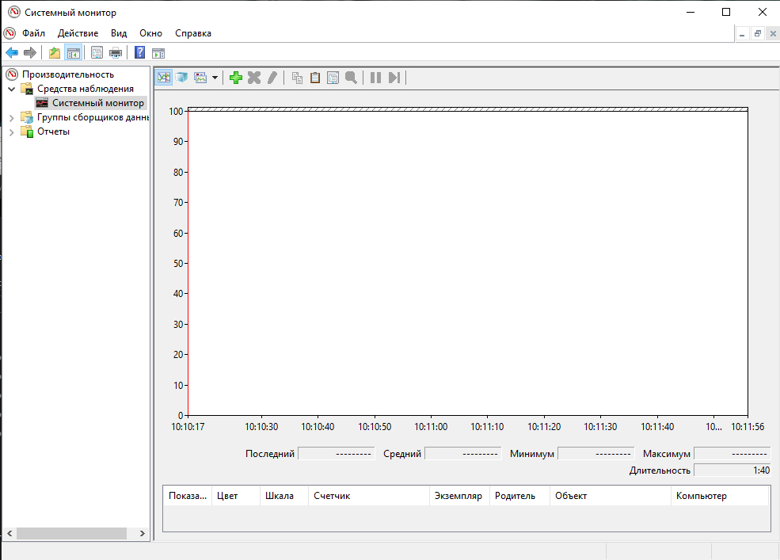
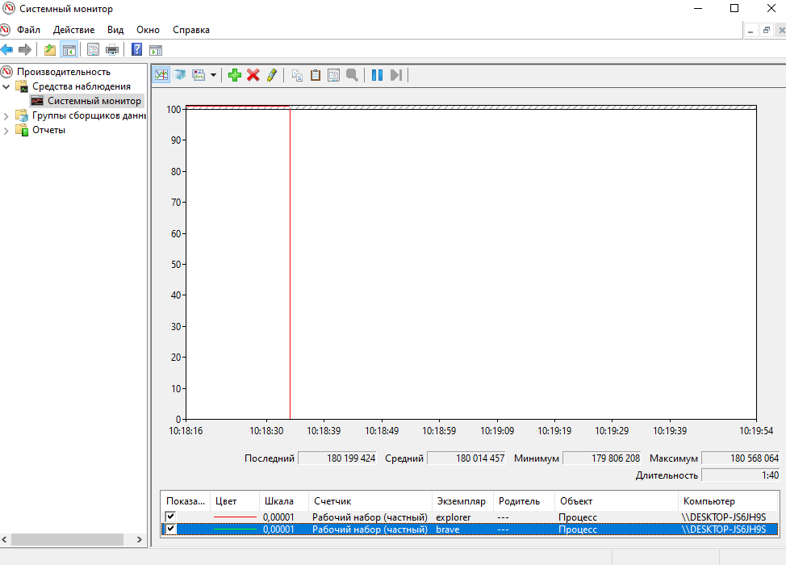
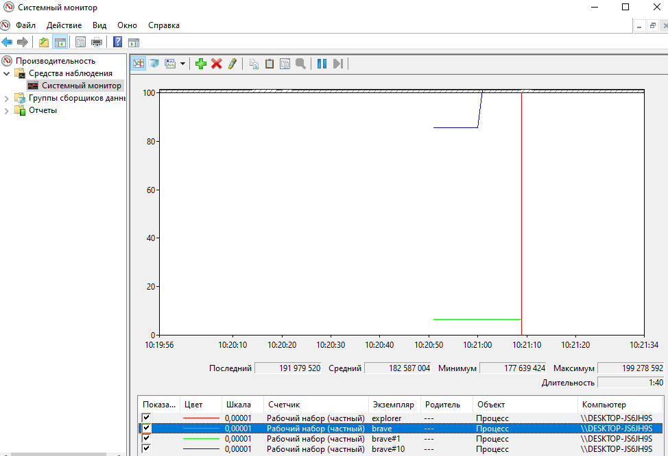
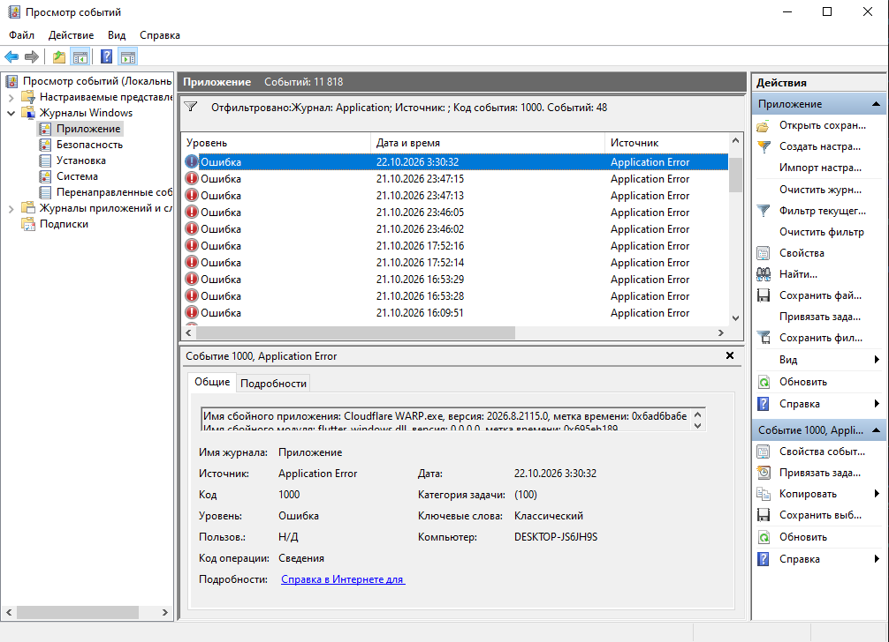
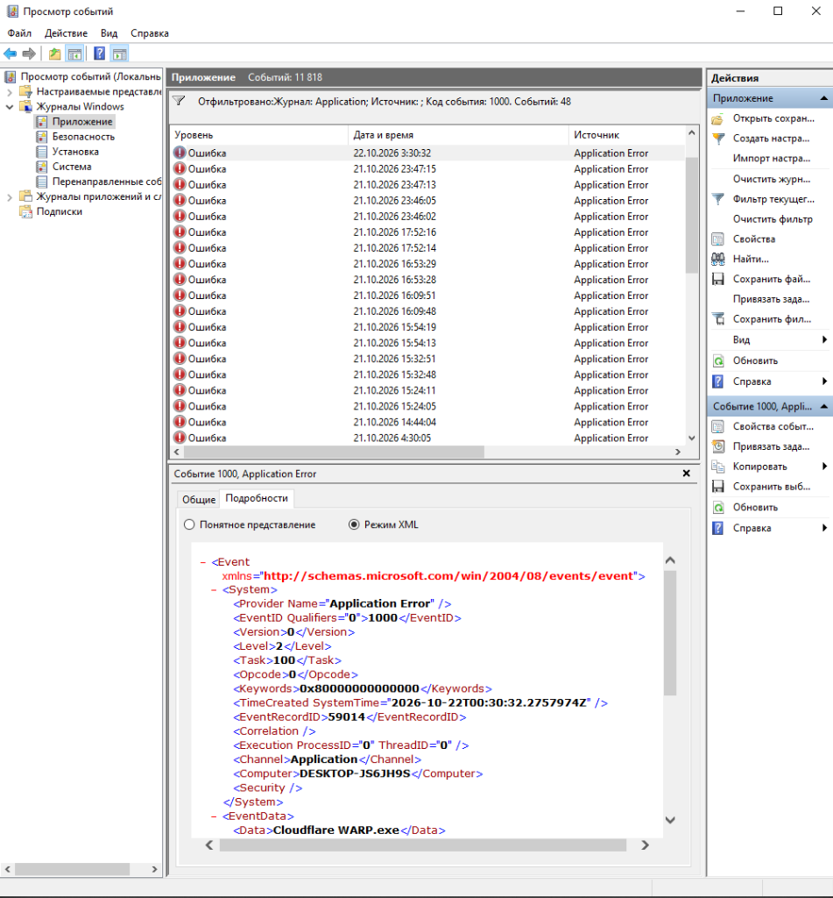
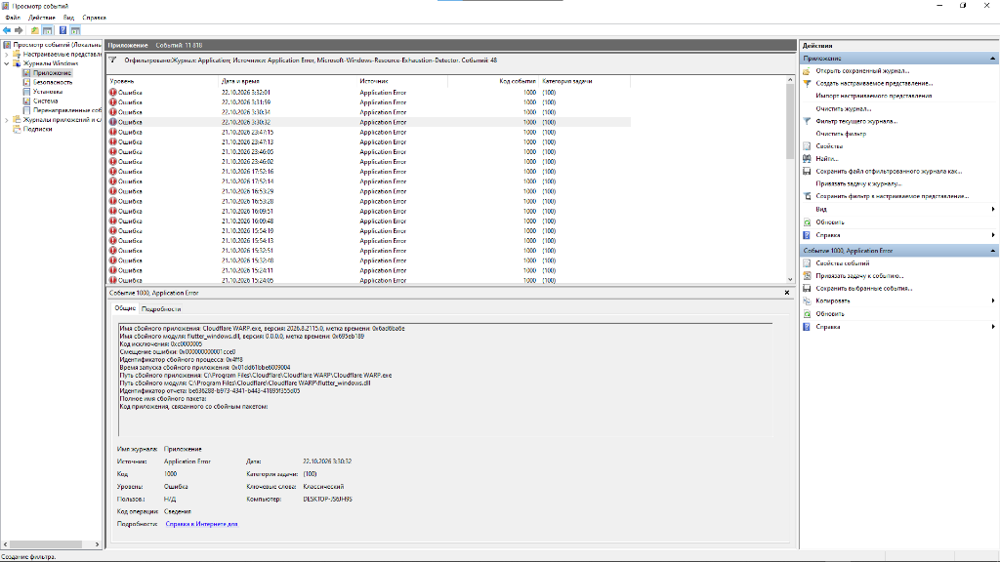

# Отчет по лабораторным работам №4 и №5

**Тема:** Профилирование производительности ПО, анализ утечек памяти (Private Bytes) и низкоуровневая дешифровка журналов событий (Event ID 1000)  
**Дисциплина:** Внедрение и поддержка программного обеспечения компьютерных систем  
**Инструментарий:** Системный монитор производительности (`perfmon.msc`), оснастка «Просмотр событий» (`eventvwr.msc`), браузер Brave  

---

# Лабораторная работа №4

**Тема:** Профилирование производительности ПО, мониторинг метрик памяти (Private Bytes) и выявление скрытых утечек ресурсов  
**Цель:** Изучить работу системных счетчиков ядра Windows для анализа потребления памяти приложением, зафиксировать динамику выделения страниц в куче (Heap) и научиться выявлять потенциальные утечки памяти (Memory Leaks).  

---

## Ход работы

### Шаг 1. Развертывание Системного монитора ядра

1. Открыл диалоговое окно «Выполнить» сочетанием клавиш `Win + R`, ввел `perfmon.msc` и запустил **Системный монитор**.
2. В левой части консоли перешел в ветку `Средства наблюдения` -> `Системный монитор` (Performance Monitor). По центру открылся интерактивный график реального времени.
3. По умолчанию монитор сразу выводит счетчик `% Processor Time` (загрузка процессора). Так как наша задача — локализовать именно поведение памяти, выделил этот счетчик в нижней таблице и нажал клавишу `Delete`. График очистился и замер в ожидании настройки.

**Скриншот №1:** Окно Системного монитора (`perfmon.msc`) в подготовленном стерильном состоянии с удаленным дефолтным счетчиком CPU перед добавлением целевых метрик.

---

### Шаг 2. Конфигурирование счетчика утечек памяти (Private Bytes)

Чтобы изолированно наблюдать за динамикой выделения памяти в куче конкретного программного процесса:
1. На панели инструментов над графиком нажал зеленый значок **«Добавить»** (`+`).
2. В списке доступных категорий счетчиков нашел и раскрыл раздел **«Процесс»** (Process).
3. Внутри категории нашел счетчик, отвечающий за закрытую память процесса — **«Рабочий набор (частный)»** (Private Bytes / Working Set - Private). 
   *Суть метрики:* в отличие от разделяемой системной памяти, частный рабочий набор отражает объем виртуальной памяти, выделенный процессу в куче, который не может использоваться другими процессами в ОС.
4. В нижнем блоке «Экземпляры выбранного объекта» выбрал рабочий процесс браузера **`brave`** (а также `explorer`).
5. Нажал кнопку **«Добавить >>»** и подтвердил кнопкой **«ОК»**. В мониторе появилась линия счетчика, фиксирующая текущий объем изолированной памяти процесса.

**Скриншот №2:** Окно Системного монитора с добавленным счетчиком `Процесс -> Рабочий набор (частный)` для процесса `brave` и фиксацией базового уровня графика.

---

### Шаг 3. Симуляция и фиксация динамики выделения ресурсов

1. Оставил график `perfmon.msc` в активном режиме записи и переключился в браузер Brave.
2. Смоделировал резкий рост нагрузки на подсистему динамической памяти: открыл несколько тяжелых веб-страниц и запустил воспроизведение видео.
3. Вернувшись к графику, зафиксировал резкий скачок синей линии счетчика вверх (момент времени 10:21:00) — процесс запросил у диспетчера памяти ядра Windows новые страницы кучи (Heap Allocation) под медиабуферы и DOM-дерево.
4. После закрытия вкладок график стабилизировался на новом уровне. Это демонстрирует нормальный жизненный цикл памяти под нагрузкой без бесконтрольного разрастания.

**Скриншот №3:** График динамики счетчика памяти, на котором четко зафиксирован скачок вверх под нагрузкой в момент открытия вкладок и последующая стабилизация линии.

---

## Вывод по ЛР №4

На практике освоен метод профайлинга процессов через системный счетчик `Рабочий набор (частный) / Private Bytes`. В отличие от моментального снимка в Диспетчере задач, Системный монитор фиксирует динамику во времени: если при циклических типовых операциях линия Private Bytes непрерывно растет «лесенкой» и не падает после завершения задачи, в приложении гарантированно присутствует утечка памяти (неосвобожденные указатели в неуправляемом коде или висячие ссылки в управляемой среде).

---
---

# Лабораторная работа №5

**Тема:** Низкоуровневый анализ журналов событий и дешифровка системных кодов падения приложений (Event ID 1000)  
**Цель:** Научиться извлекать дампы аварийных сбоев из структурированных журналов Windows Event Log (`.evtx`), идентифицировать сбойные бинарные модули, смещения в коде, анализировать причины сбоев по кодам исключений и отслеживать сигналы дефицита системных ресурсов.  

---

## Ход работы

### Шаг 1. Локализация логов падения прикладного ПО

1. Нажал `Win + R`, ввел `eventvwr.msc` и запустил оснастку **«Просмотр событий»** (Event Viewer).
2. В дереве слева раскрыл папку `Журналы Windows` -> выбрал журнал **«Приложение»** (Application).
3. В правой панели действий кликнул **«Фильтр текущего журнала...»** (Filter Current Log).
4. В поле «Включая/исключая коды событий...» указал системный код аварийного падения пользовательских процессов: **1000** и нажал «ОК».
5. В отфильтрованном списке отобразились события сбоев `Application Error`, зафиксированные операционной системой (всего 48 инцидентов). Выбрал верхнее событие краша прикладной программы для детального технического разбора.

**Скриншот №1:** Окно «Просмотра событий» с активным фильтром по коду события 1000 и списком зафиксированных сбоев приложений.

---

### Шаг 2. Дешифровка технических параметров дампа ошибки

На вкладке «Общие» выбранного события Event ID 1000 извлек ключевые данные для локализации бага:
- **Имя сбойного приложения:** `Cloudflare WARP.exe` (версия 2026.8.2115.0)
- **Имя сбойного модуля:** `flutter_windows.dll` (библиотека графического движка Flutter)
- **Код исключения (Exception Code):** `0xc0000005` (STATUS_ACCESS_VIOLATION — нарушение прав доступа к памяти)
- **Смещение ошибки (Faulting Offset):** `0x000000000001cce0`

Затем переключился на вкладку **«Подробности»** (Details) и выбрал режим **«Режим XML»**. В этом представлении лог структурирован по узлам:
- `<EventID Qualifiers="0">1000</EventID>` — идентификатор класса ошибки;
- `<Provider Name="Application Error" />` — источник сбоя;
- `<Data>Cloudflare WARP.exe</Data>` — сбойное приложение;
- `<TimeCreated SystemTime="..." />` — точная временная метка аварии.

Именно в таком машиночитаемом формате дампы ошибок автоматически агрегируются корпоративными SIEM-системами и системами мониторинга жизненного цикла ПО (CALS).

**Скриншот №2:** Вкладка «Подробности» события с открытым XML-представлением тегов `<EventID>`, `<Provider>`, `<Data>Cloudflare WARP.exe</Data>`.

---

### Шаг 3. Мониторинг системных предупреждений производительности ядра

Помимо критических падений (Event ID 1000), ядро Windows протоколирует предкритические состояния, когда софт монополизирует виртуальную память:
1. В правой панели нажал «Фильтр текущего журнала...».
2. В строке источников событий выбрал **Microsoft-Windows-Resource-Exhaustion-Detector** и **Application Error**.
3. Модуль Resource-Exhaustion-Detector отслеживает моменты, когда физическая RAM и файл подкачки (`pagefile.sys`) подходят к пределу, и ОС вынуждена выдавать предупреждения о закрытии программ для предотвращения потери данных.
4. Отфильтровал системный лог, сопоставив источники сбоев и истощения ресурсов для комплексного анализа состояния подсистемы памяти рабочей станции.

**Скриншот №3:** Лог журнала с фильтрацией по источникам `Application Error` и `Microsoft-Windows-Resource-Exhaustion-Detector`.

---

## Вывод по ЛР №5

Изучена архитектура подсистемы журналирования Windows Event Log. На практике доказано, что при падении программы у заказчика нет необходимости наугад перезапускать систему или гадать по описанию «у меня вылетело». Системный лог Event ID 1000 дает исчерпывающую триаду параметров: упавший модуль (`flutter_windows.dll`), код исключения процессора (`0xc0000005`) и точное смещение инструкции (`0x0001cce0`). Это позволяет разработчикам через файл отладочных символов (`.pdb`) сразу локализовать конкретную строку исходного кода, приведшую к краху.

---
---

# Ответы на инженерные вопросы для защиты

### К Лабораторной работе №4:

#### 1. Что показывает счетчик Private Bytes (Закрытые байты) и почему именно по его графику ИТ-специалисты определяют наличие багов, связанных с утечками памяти в коде?
**Ответ:**  
Счетчик `Private Bytes` (в русской версии — *«Рабочий набор (частный)» / «Закрытые байты»*) показывает фактический объем виртуальной памяти, который процесс запросил у операционной системы для личных нужд (преимущественно под динамические структуры в куче — Heap) и который физически не может быть разделен с другими приложениями (в отличие от `Shared Memory` или общего рабочего набора `Working Set`, куда входят общие системные DLL).

При нормальной работе программы график `Private Bytes` имеет пилообразную или волнообразную форму: память выделяется под задачу -> задача выполняется -> память освобождается деструктором или сборщиком мусора (GC) -> график возвращается на базовый уровень. 

Если в коде есть утечка памяти (Memory Leak) — например, программист на C++ выделил память через `new`/`malloc` и потерял указатель, либо на C#/Java оставил висячую статическую ссылку на объект — график `Private Bytes` при повторяющихся операциях будет неуклонно расти ступенями вверх («лесенкой») и никогда не вернется к исходному значению. Для инженера такой непрерывный рост счетчика — стопроцентный маркер дефекта управления памятью.

---

#### 2. Опишите физический смысл процесса подкачки (Paging) операционной системы. Почему компьютер начинает сильно тормозить, когда счетчик Page Faults/sec резко возрастает?
**Ответ:**  
Механизм **подкачки (Paging)** — это архитектурное решение Windows, позволяющее изолированным процессам использовать виртуальное адресное пространство, превышающее физический объем планок оперативной памяти (ОЗУ). Вся память разбита на страницы фиксированного размера (обычно по 4 КБ). Когда приложениям не хватает физической ОЗУ, диспетчер памяти ядра выгружает неактивные страницы данных на постоянный накопитель в скрытый системный файл `pagefile.sys`.

Когда поток обращается по виртуальному адресу к данным, которые в данный момент выгружены на диск, центральный процессор генерирует аппаратное прерывание — **ошибку страницы (Page Fault)**. Диспетчер памяти перехватывает его, приостанавливает выполнение потока, находит нужную страницу в `pagefile.sys`, считывает ее с диска и загружает обратно в свободный блок ОЗУ.

Резкий рост показателя `Page Faults/sec` означает, что процессору постоянно не хватает физической памяти для рабочих страниц, и система начинает непрерывно «молотить» диск чтением и записью блоков подкачки (явление *Thrashing*). Так как время отклика и пропускная способность даже быстрого SSD/NVMe на несколько порядков ниже регистров и шины ОЗУ, потоки встают в жесткое ожидание дискового ввода-вывода (I/O Bound), что приводит к зависанию интерфейса и общей деградации производительности всей ОС.

---

### К Лабораторной работе №5:

#### 3. Вы открыли лог падения программы (Event ID 1000) и увидели в поле «Код исключения» значение 0xc0000005. Какую ошибку совершил программист при написании кода приложения, приведшую к этому статусу ядра?
**Ответ:**  
Код `0xc0000005` — это статус ядра **`STATUS_ACCESS_VIOLATION` (Нарушение прав доступа к памяти)**. На уровне процессора это означает, что поток попытался выполнить операцию чтения или записи по адресу виртуальной памяти, к которому у него нет прав, либо этот адрес не существует (страница не отображена в адресное пространство процесса).

Типичные ошибки программиста, вызывающие данное исключение:
1. **Разыменование нулевого указателя (Null Pointer Dereference):** обращение к полям или методам объекта по указателю `nullptr` / `null` (попытка прочитать адрес в районе `0x00000000`).
2. **Использование памяти после освобождения (Use-After-Free):** обращение к объекту по старому («дикому») указателю, когда память под него в куче уже была отдана через `free()` / `delete`.
3. **Выход за границы массива (Buffer Overrun):** запись или чтение данных за пределами выделенного блока памяти, приведшая к попаданию на защищенную служебную страницу памяти (Guard Page).
4. **Попытка записи в область «только для чтения» (Write to Read-Only):** попытка перезаписать секцию константных данных или исполняемый код программы.

---

#### 4. Для чего в концепции CALS-технологий (управления жизненным циклом) лог падения софта экспортируют в структурированный формат XML, а не хранят в виде обычного скриншота экрана?
**Ответ:**  
В парадигме **CALS (Continuous Acquisition and Life-cycle Support / Информационная поддержка жизненного цикла изделий)** ключевой постулат — создание единого интегрированного информационного пространства без потерь и искажений данных.

Преимущества формата XML перед графическим скриншотом:
1. **Автоматический машинный парсинг и агрегация:** XML — это строгий машиночитаемый формат с четкой схемой. Автоматизированные системы сопровождения (HelpDesk, Bug Tracker, SIEM, APM) могут без участия человека распарсить файл, автоматически извлечь теги `<AppName>`, `<ModuleName>`, `<ExceptionCode>`, `<FaultingOffset>` и сгруппировать миллионы инцидентов от пользователей в одну сводную задачу для разработчиков. Со скриншотом сквозная автоматизация невозможна (требуется ненадежное OCR или ручной труд оператора).
2. **Интеграция с конвейером CI/CD и отладчиками:** Извлеченные из XML смещение ошибки (`FaultingOffset`) и имя модуля можно программно передать в скрипт анализа дампа (например, через WinDbg) вместе с файлом отладочных символов (`.pdb`), чтобы автоматически определить строку исходного кода в репозитории Git, где упала программа.
3. **Объем и надежность хранения:** XML-файл занимает всего пару килобайт текста в БД инцидентов, индексируется полнотекстовым поиском и легко передается по низкоскоростным защищенным каналам связи, в то время как растровые скриншоты весят в сотни раз больше и не поддаются быстрой аналитической выборке.
